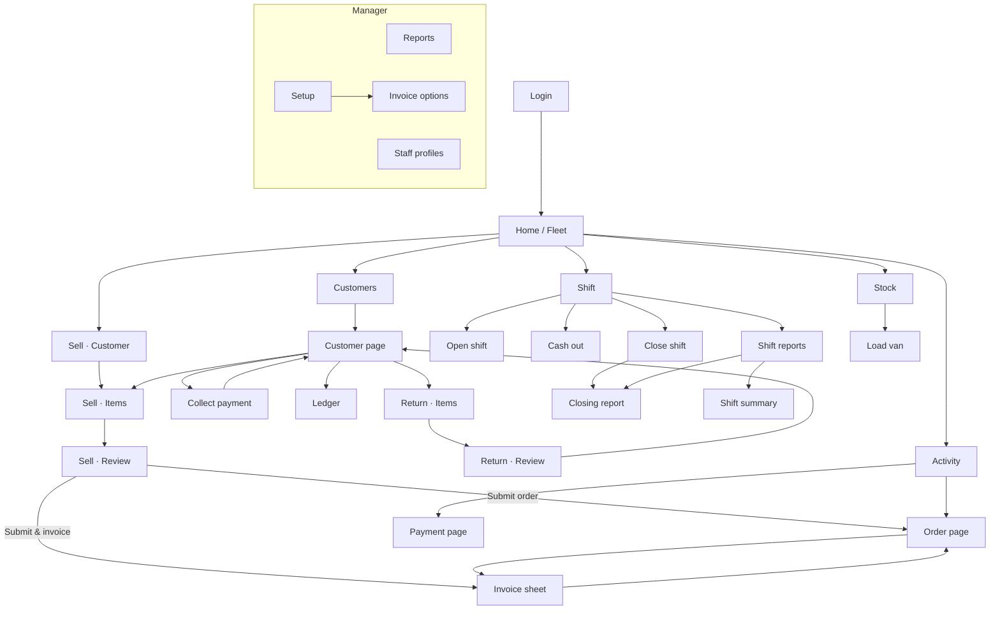

# Sales App — Product Requirements Document

## 1. App Overview

**Sales App** is a mobile-first Progressive Web App (PWA) for ERPNext field sales. It serves two kinds of staff from one app, chosen per Sales Profile:

- **Van Sales** — drivers who carry stock: take orders, invoice and deliver on the spot, take returns, load the van, collect payments, and run a cash shift with an opening float, expenses and deposits out of the drawer, and a counted-cash closing.
- **Field Sales** — order takers with no van: take orders and collect payments, see read-only stock from a chosen warehouse, and leave invoicing, delivery and returns to the back office. Shifts are optional for them.
- **Counter Sales** — a cashier or data entry operator at a PC: keys orders in on the keyboard-first Counter screen, sells and invoices straight from one warehouse, collects payment on the spot, and can start every sale on a default (walk-in) customer. Shifts work as for a van.

Everything is backed by standard ERPNext documents (Sales Order, Sales Invoice, Payment Entry, Stock Entry, Journal Entry). The app adds its own documents only for configuration (Sales Profile), shifts (Sales Shift Opening / Closing) and drawer cash movements (Sales Cash Movement). ERPNext documents are never stamped with a shift: shift totals are attributed by driver and creation time inside the shift's window.

---

## 2. Core Features

- **Profile types** — Each Sales Profile is Van Sales, Field Sales or Counter Sales. The type drives a capability set (`can_invoice`, `can_deliver`, `can_return`, `can_load_stock`, `can_view_stock`, `can_counter_sell`, `uses_shifts`, `requires_open_shift`) that gates screens in the app and is enforced again on every endpoint.
- **Counter** (Counter Sales, and managers) — One PC screen for fast typed entry: customer box, lines grid with an always-open entry row (code, name or barcode → qty → Enter), live totals from ERPNext (re-taxed to the invoice option, with the proposed invoice number and stock shortages), payment choice, and F-key actions: hold (draft), submit order, submit and invoice (one request, one transaction, printed at once when a printer is set), print last. A side panel holds the cashier's held orders, orders still to invoice and today's invoices.
- **Field Order Entry** — Select a customer, browse a price-list-aware catalog with stock from the van (or the Field Sales stock warehouse, read-only), build a cart with editable rates and discounts, and submit Sales Orders into ERPNext.
- **Payment Collection & Allocation** — Collect receivables with Auto-FIFO, Manual, or Advance allocation against outstanding Sales Invoices or Sales Orders.
- **Van Stock Management** (Van Sales) — Real-time stock dashboard for the van warehouse with low-stock alerts, plus a guided Material Transfer from the source warehouse.
- **Invoicing, delivery and returns** (Van Sales) — Invoice an order from the van, deliver pending items later, and issue Credit Notes for returns.
- **Shifts** (POS Awesome style) — Open a shift with a per-mode cash float; record expenses and cash deposits to the office from the drawer, each posted as a Journal Entry; close the shift by counting each payment mode against the expected amount. The closing stores sales, net, taxes, quantity, returns, collections, expenses, deposits, expected cash and the per-mode reconciliation, plus a frozen list of every document it summed.
- **Variance tolerance** — A per-profile tolerance flags a closing as Balanced, Within Tolerance or Exceeds Tolerance. It never blocks a closing; managers see flagged closings on the dashboard and in reports.
- **Shift reports** — A live Shift Summary while the shift is open and a final Closing Report once closed, in the app and as print formats.
- **Manager tools** — Fleet dashboard for today (shift status per staff member, cash on open shifts, alerts for stale shifts, variances, drafts left at close and trading without a shift), period reports with comparison to the previous period, closing any driver's shift, and reopening a closed shift.
- **Stale-shift job** — A daily scheduled task notifies managers of shifts still open from earlier days.

---

## 3. User Stories

| # | Persona | Story |
|---|---------|-------|
| 1 | **Van driver** | *As a van driver, I want to browse my catalog filtered by the customer's price list and instantly see van stock levels so I can place accurate orders on-site without calling the office.* |
| 2 | **Field sales rep** | *As a field rep without a van, I want to take orders and collect payments and see what the warehouse has, without being offered invoicing or delivery actions I am not allowed to do.* |
| 2b | **Cashier** | *As a cashier at the shop PC, I want to type item codes and quantities and press one key to turn the sale into a submitted order, or an order plus a paid invoice, so nobody has to re-key it in the desk.* |
| 3 | **Driver** | *As a driver collecting a cheque, I want to allocate the payment against the customer's oldest invoices (FIFO) or manually pick specific invoices, so the customer's ledger is updated in real-time.* |
| 4 | **Van driver** | *As a driver returning unsold goods, I want to select items and quantities so a Credit Note is created and the customer's outstanding balance is reduced automatically.* |
| 5 | **Van driver** | *As a driver paying for fuel or handing cash to the office mid-route, I want to record it from the app so my expected cash at closing is right and the accounts are posted without a cashier re-keying it.* |
| 6 | **Driver** | *As a driver ending my shift, I want to count each payment mode against what is expected, see whether I am within tolerance, and see any draft orders I forgot to submit, before the shift closes.* |
| 7 | **Sales Manager** | *As a sales manager, I want to configure each profile (type, warehouses, payment modes, cash accounts, expense rules, variance tolerance) from one screen, so onboarding a new staff member takes minutes.* |
| 8 | **Sales Manager** | *As a sales manager, I want to see at a glance who is on shift, how much cash each van holds, which closings were off by more than I tolerate, and which shifts were never closed, and to close or reopen a shift myself when needed.* |

---

## 4. User Roles (RBAC)

| Role | Access Level |
|------|-------------|
| **System Manager** | Full admin — CRUD on all doctypes, all API endpoints, can delete records. |
| **Sales Manager** | Operations manager — manage Sales Profiles, view all reports, close and reopen any shift, cancel cash movements. Cannot delete. |
| **Sales App User** | Field staff (both profile types) — the role is assigned automatically to users on an active Sales Profile. Holds read-only DocPerms on Sales Order and on all Sales App documents; every write goes through a whitelisted endpoint that authorizes the caller (own data, own open shift, profile rules) and then bypasses DocPerms. Row-level isolation: own data only. |

---

## 5. Screen Inventory

The app is organised around five tabs (phone) or a rail (tablet/desktop). Everyone gets **Home**, **Sell**, **Customers** and **More**; the fourth tab is **Stock** for a van with stock access, **Reports** for a manager without a profile, and **Activity** otherwise. **More** lists everything else the person may reach. Each job has one place: selling is a three-step flow, everything about a customer starts from the customer page, and the shift has its own area.

### 5.1 Login
**Route:** `/login` — username and password against ERPNext; on success the session (user, roles, driver config, capabilities) is stored and the app opens on Home (or on the page that was asked for).

### 5.2 Home
**Route:** `/`

| Person | What it shows |
|--------|---------------|
| **Staff** | Greeting and shift chip (open since / unclosed / none) · a shift gate card when a shift must be opened or closed first · the **New sale** button and a **Resume sale** row when a draft is in progress (drafts survive refreshes) · shortcuts: Collect payment, Return, Load van, Cash out, Ledger (by capability) · **This shift** tiles on an open shift · **Today** tiles (orders, collected) · recent orders. |
| **Manager without a profile** | **Fleet home**: today's collections, open/closed shift counts, shortcuts (New sale, Reports, Staff, Setup), fleet tiles, alerts (stale shifts, variances, drafts, trading without a shift) with close/report links, one card per staff member with Close Shift. |

### 5.3 Sell (three steps)
**Routes:** `/sell/customer` → `/sell/items` → `/sell/review` (tabs hidden; a step header shows progress)

| Step | Detail |
|------|--------|
| **Customer** | Search (name, ID, mobile), New customer sheet (when the profile allows), "Continue with" the draft's customer. `?customer=` skips the step. |
| **Items** | Price-list-aware catalog with stock badges and sales history per item, quantity sheet (whole-number UOMs step by one), running total bar. Editing a draft order shows which one. |
| **Review** | Lines with quantity and editable price (when allowed), discount (percent or amount, capped by the profile), totals, then **Submit order** or **Submit & invoice**. The second opens the invoice sheet (below) on the freshly submitted order. Both end on the order page. |

The draft (customer, lines, discount, the draft order being edited) is kept per user in local storage.

### 5.3b Counter
**Route:** `/counter` (Counter Sales staff; managers too)

| Area | Detail |
|------|--------|
| **Customer** | Typeahead by name, ID or mobile (F2), New customer when the profile allows, outstanding balance when it shows balances. A Counter Sales profile's default customer is preselected on every new sale. |
| **Lines** | Grid of independent lines (the same item twice is two lines): qty and, when allowed, rate editable in place; stock from the selling warehouse; a shortage badge from the preview. The entry row above the lines takes code, name or barcode, an exact code adds on Enter, then qty, Enter lands the line. |
| **Totals** | ERPNext's own figures for the cart: subtotal, discount (percent or amount, capped by the profile), tax lines, grand and rounded total, proposed invoice number. A cart the profile refuses shows the reason instead of totals. |
| **Payment** | Paid now (mode of payment) or credit, the invoice options that fit, print-at-once toggle when a printer is set. |
| **Actions** | F7 hold (draft Sales Order), F8 submit order, F9 submit and invoice in one request, F10 print last invoice, Esc clear. |
| **Queue** | Held (Resume), To invoice (opens the invoice sheet), Today's invoices (Print). |

### 5.4 Invoice sheet (shared)
Opened from Review ("Submit & invoice") and from an order. Step 1: credit or paid now, mode of payment, and the invoice options that fit that payment rule (one option is pre-selected). Step 2: the proposed invoice number, lines, taxes and totals as ERPNext computes them, a note when the order is re-taxed to the option, and the stock shortage rule. Confirm creates the Sales Invoice (and the payment when paid now).

### 5.5 Customers and the customer page
**Routes:** `/customers` · `/customers/:name`

The list searches by name, ID or mobile and can add a customer. The customer page is the hub for everything about one customer: balance and last invoice/payment (when the profile shows balances), actions **New sale**, **Collect payment**, **Return**, **Ledger**, the outstanding invoices and recent orders.

### 5.6 Collect payment
**Route:** `/customers/:name/collect` — amount and mode, then allocation: Auto (oldest invoices first), Manual (pick invoices and amounts) or Advance (optionally against a sales order). Ends back on the customer page.

### 5.7 Customer ledger
**Route:** `/customers/:name/ledger` — period chips, opening/invoiced/received tiles, transactions with running balance, outstanding balance.

### 5.8 Return
**Routes:** `/customers/:name/return` → `/customers/:name/return/review` — pick items and quantities, review the credit, issue the credit note. Ends on the customer page.

### 5.9 Activity
**Route:** `/activity?tab=orders|payments` — orders and payments the person recorded, searchable with a date filter, paged. Opens the order page or the payment page.

### 5.10 Order page
**Route:** `/orders/:name` — status, customer (links to the customer page), items, totals. Draft: Edit (reopens the sale flow on it) and Submit. Submitted: Create invoice (invoice sheet), Deliver pending items once billed short of stock, Print, Collect payment. Field Sales sees that the back office invoices.

### 5.11 Payment page
**Route:** `/payments/:name` — amount, date, mode, allocations, print, link to the customer.

### 5.12 Stock
**Routes:** `/stock` · `/stock/load` — live stock of the selling warehouse with low-stock alerts and search; **Load van** builds a Material Transfer from the main warehouse (batches and serials handled per item).

### 5.13 Shift
**Routes:** `/shift` · `/shift/open` · `/shift/close` · `/shift/cash` · `/shift/reports` · `/shift/summary` · `/shift/closing-report/:name`

The shift page shows the state (no shift / open since / unclosed from an earlier day) with the one action that fits, this shift's tiles and drafts, recent cash movements and the reports. Open declares the float per mode. Cash out records an expense or a deposit to the office (each a Journal Entry) and offers to close the shift after a deposit. Close counts every mode against the expected amount (or blind), flags the variance against the tolerance, lists drafts and activity outside the window, and opens the closing report. Managers close or reopen any shift from the fleet home or a report.

### 5.14 Manager: Reports, Staff, Setup
**Routes:** `/reports` · `/staff` · `/setup` · `/setup/invoice-options`

Reports: any period compared with the previous one, by driver, items, customers, collections, expenses and closed shifts, printable. Staff: the Sales Profiles (type, warehouses, payment modes, cash accounts, staff controls, invoice options, assigned staff). Setup: invoice options (numbering series, tax template, payment rule), a link to Staff, appearance, and a short note on how access works.

### 5.15 More
**Route:** `/more` — the rest of the navigation for this person (Activity, Stock, Shift, Reports, Staff, Setup), appearance and sign out.

### 5.16 App shell
`AppShell.vue` renders the tabs or rail from `navigation.ts`, the offline notice, the toast queue and the confirm dialog. Flows (sale steps, shift open/close, collect, return, load van) hide the tabs so the primary action owns the bottom edge. The router keeps every old path working through redirects.

---

## 6. Navigation Flow Diagram

---

## 7. Backend DocTypes

| DocType | Purpose |
|---------|---------|
| `Sales Profile` | Configuration per van or field team (modeled after POS Profile): profile type, warehouses, staff, customer groups, payment modes, controls, shift and cash movement settings, pricing and accounting defaults |
| `Sales Profile Driver` / `Sales Profile Payment Mode` / `Sales Profile Customer Group` / `Sales Profile Expense Account` | Child tables of Sales Profile |
| `Sales Shift Opening` | A shift: driver, date, status, `period_start`, opening float per mode (`Sales Shift Balance Detail`), and once closed `period_end` and `closing_shift` |
| `Sales Shift Closing` | The closing: totals (sales, net, taxes, quantity, returns, collections, expenses, deposits, opening float, expected cash, net difference), variance tolerance and status, drafts left, `Sales Shift Closing Tax` rows, `Sales Shift Payment Reconciliation` rows, and `Sales Shift Transaction` references to every document summed |
| `Sales Cash Movement` | Expense or Deposit out of the drawer on an open shift, with frozen source / target accounts and the Journal Entry it posted |
| `Sales Expense Log` | Legacy expense entries without accounting; read-only for drivers, still counted in history |
| `Sales EOD Report` | Legacy end-of-day record, superseded by shifts |

---

## 8. Backend API Modules (`sales_pwa/sales_app/`)

| Module | Responsibility |
|--------|---------------|
| `sales.py` | Sales Order CRUD, invoicing, delivery of pending items, returns, daily summary and log |
| `counter.py` | The Counter: ranked item search with price and stock, cart totals preview, order+invoice+payment in one request, the cashier's queue |
| `finance.py` | Payment Entry creation, outstanding invoices, customer summary / ledger, payment modes |
| `inventory.py` | Stock dashboard, stock transfer, transfer item search / detail |
| `shift.py` | Open / close / reopen shifts, closing summary, window aggregation (`_compute_closing`), `require_open_shift` |
| `shift_report.py` | Shift summary and closing report builders, closings list, print format data |
| `cash_movement.py` | Cash movement context, create, list, manager cancel |
| `manager_report.py` | Manager dashboard and period reports |
| `tasks.py` | Scheduled jobs: daily stale-shift notification to managers |
| `van_profile.py` | Sales Profile CRUD, options and the per-driver config payload |
| `driver.py` | App context (session, driver config, capabilities), setup options |
| `utils.py` | Authorization helpers (`_require_van_user`, `_require_capability`, customer access), capability model, driver config cache |
| `setup.py` | App installation hooks (role creation, permissions) |
